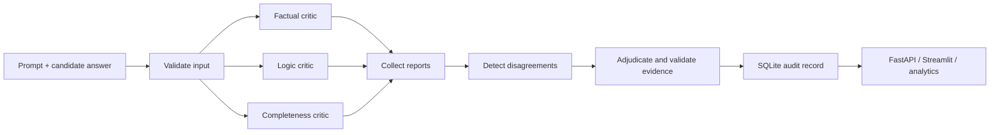
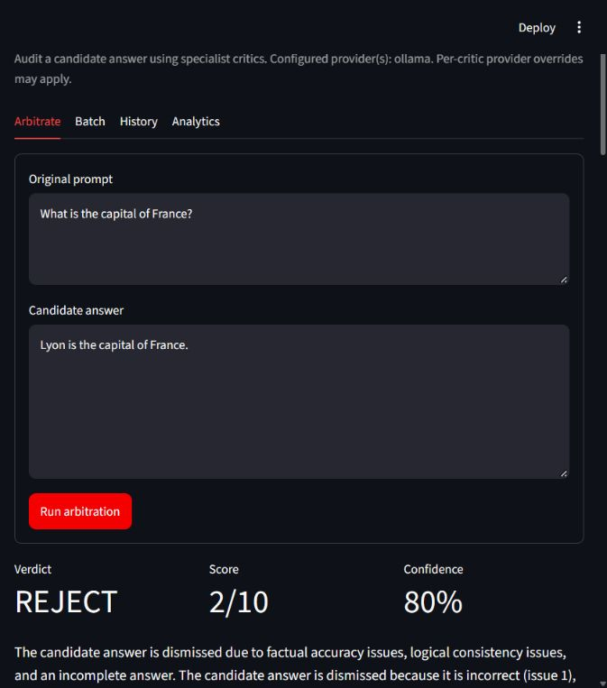
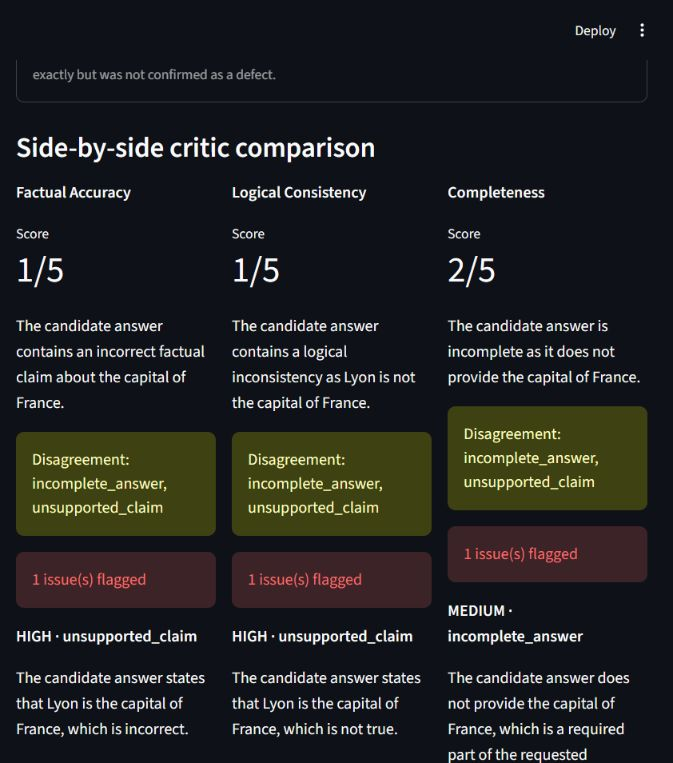
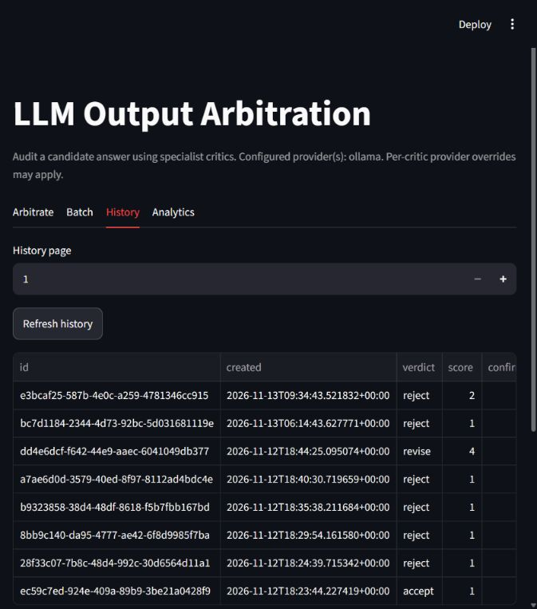

# LLM Output Arbitration System

An audit service for an answer that an LLM has already generated. It runs independent critics for factual accuracy, logical consistency, and completeness, detects disagreements, asks an adjudicator to resolve reported issues, and stores a structured result. It evaluates answers; it does not generate a replacement answer.

The `mock` provider is for local wiring and UI work. It returns deterministic placeholder judgments and does **not** evaluate meaning. Do not use mock metrics as model-quality results.

## Features

- Pydantic-validated requests, critic reports, disagreements, and verdicts.
- Parallel LangGraph critic execution with per-critic timings, retries, and partial-result handling.
- Atomic SQLite persistence for batch results; input validation happens before provider calls.
- OpenAI, Anthropic, Ollama's OpenAI-compatible API, and deterministic mock provider.
- Exact evidence quote validation against the candidate answer.
- Deterministic disagreement detection and evidence-checked adjudication, including a unanimous-good shortcut.
- SQLite audit history, single and batch API endpoints, retrieval, analytics, and a Streamlit explorer.
- A versioned 21-case starter evaluation dataset, runner, case-level results, and failure counts.
- Provider-returned model attribution, prompt-version metadata, configurable input-character/output-token budgets, and paginated history.
- Docker Compose configuration for the API and UI.

## Architecture and workflow



Critic scores range from 1–5; final scores range from 1–10. Issue evidence must be an exact substring of the candidate answer. The adjudicator must confirm or dismiss every issue reported by critics. If a critic fails, the remaining critics continue and the result carries an error and reduced confidence.

## Technology

Python 3.11+, Pydantic, LangGraph, FastAPI, SQLite, Streamlit, pandas, OpenAI SDK, Anthropic SDK, Docker Compose, and pytest.

## Project structure

```text
src/                 Arbitration pipeline, providers, schemas, persistence, and evaluation
ui/                  Streamlit verdict explorer
scripts/             Evaluation and controlled prompt-comparison runners
tests/               Offline regression suite, demo cases, and reviewed evaluation data
docs/                Architecture, provider/deployment notes, experiment reports, and portfolio material
docs/screenshots/    Genuine application screenshots
docs/demo/           Recorded application walkthrough
docs/experiments/    Reproducible baseline and prompt-comparison result artifacts
Dockerfile           API/UI container image definition
docker-compose.yml   Local API + dashboard deployment
requirements.lock.txt  Reproducible Python dependency pins
```

## Installation

### Windows PowerShell

```powershell
py -3.11 -m venv .venv
./.venv/Scripts/Activate.ps1
python -m pip install -r requirements.lock.txt
if (-not (Test-Path .env)) { Copy-Item .env.example .env }
```

If the Python launcher is unavailable, use the full path to your Python 3.11 executable for `-m venv`, then activate the environment as above. On macOS/Linux, use `python3.11 -m venv .venv` and `source .venv/bin/activate`.

The lockfile pins the dependency set used for fresh-environment verification. `requirements.txt` contains supported version ranges for dependency updates.

## Configuration

Copy `.env.example` to `.env` and change only the settings needed for your provider. Never put credentials in source files, command history, experiment reports, or screenshots. `.env` is ignored by Git.

| Variable | Purpose |
|---|---|
| `APP_ENV` | Environment label. |
| `LLM_PROVIDER` | `mock`, `openai`, `anthropic`, or `ollama`; defaults to `mock`. |
| `LLM_MODEL` | Model identifier supported by the selected provider. Set this when changing from the example mock configuration. |
| `OPENAI_API_KEY`, `ANTHROPIC_API_KEY` | Credentials required for those provider clients. |
| `FACTUAL_PROVIDER`, `LOGICAL_PROVIDER`, `COMPLETENESS_PROVIDER` | Optional per-critic provider overrides. |
| `FACTUAL_MODEL`, `LOGICAL_MODEL`, `COMPLETENESS_MODEL` | Optional per-critic model overrides. |
| `LLM_TEMPERATURE` | Sampling temperature for OpenAI and Ollama-compatible clients; defaults to `0`. The Anthropic client omits this parameter because current Claude models/SDK versions reject it; record Anthropic runs as provider-default sampling. |
| `LLM_TIMEOUT_SECONDS`, `LLM_MAX_RETRIES` | Provider timeout and retry count. |
| `LLM_MAX_OUTPUT_TOKENS` | Maximum generated response tokens per provider call; defaults to `2048`. |
| `MAX_PROVIDER_INPUT_CHARS` | Maximum combined system/user request characters checked before sending; defaults to `100000`. This character cap does not replace a model-specific tokenizer/context-window check. |
| `OPENAI_MAX_INPUT_CHARS`, `ANTHROPIC_MAX_INPUT_CHARS`, `OLLAMA_MAX_INPUT_CHARS` | Provider-specific request character budgets; each defaults to `100000`. |
| `OPENAI_MAX_OUTPUT_TOKENS`, `ANTHROPIC_MAX_OUTPUT_TOKENS`, `OLLAMA_MAX_OUTPUT_TOKENS` | Provider-specific output caps; the example configuration sets each to `2048`. If omitted, each falls back to `LLM_MAX_OUTPUT_TOKENS`. |
| `FACTUAL_THRESHOLD`, `LOGICAL_THRESHOLD`, `COMPLETENESS_THRESHOLD` | Minimum scores used by the unanimous-good shortcut. |
| `MAX_PROMPT_CHARS`, `MAX_ANSWER_CHARS`, `MAX_BATCH_SIZE` | Prompt/answer and batch limits. The synchronous batch default is `2`; the configurable maximum is `20`. The UI computes its request timeout from the configured per-call timeout and retry count. |
| `DATABASE_PATH` | SQLite file path; defaults to `data/arbitrations.sqlite3`. |
| `OLLAMA_BASE_URL` | Native/local Ollama endpoint; defaults to `http://localhost:11434/v1`. |
| `OLLAMA_DOCKER_BASE_URL` | Compose Ollama host URL; defaults to `http://host.docker.internal:11434/v1`. |
| `LOG_LEVEL` | Python logging level. |

Provider calls send the original prompt, candidate answer, and critic reports to the configured provider. Use only data you are permitted to share with that service.

### Provider setup

- **OpenAI:** set `LLM_PROVIDER=openai`, a model identifier accepted by your account, and `OPENAI_API_KEY` in local `.env`.
- **Anthropic:** set `LLM_PROVIDER=anthropic`, a model identifier accepted by your account, and `ANTHROPIC_API_KEY` in local `.env`.
- **Ollama:** install Ollama, pull a local model, set `LLM_PROVIDER=ollama` and `LLM_MODEL` to that installed model. Native runs use `OLLAMA_BASE_URL`; Docker Compose uses `OLLAMA_DOCKER_BASE_URL`. A real local run with `qwen2.5:1.5b` is documented in [`docs/ollama-local-model-evaluation.md`](docs/ollama-local-model-evaluation.md); its measured false-positive rate was high, so do not treat it as a quality endorsement.
- **Mock:** requires no credentials and does not make provider calls or perform semantic evaluation.

The adapters use the provider SDKs' chat/messages request formats and enforce the shared JSON schema locally. Verify model access against the provider's [OpenAI chat API](https://platform.openai.com/docs/api-reference/chat/create), [Anthropic Messages API](https://docs.anthropic.com/en/api/messages), and [Ollama OpenAI compatibility reference](https://docs.ollama.com/api/openai-compatibility). Anthropic model and parameter availability changes over time; the client intentionally omits temperature for compatibility with current SDK/model behavior. The project does not verify account entitlements or model availability without a live request.

The offline suite uses mocks and does not establish provider quality. A real local Ollama judgment and 20-case evaluation were run with `qwen2.5:1.5b`; see the evaluation report for results and telemetry limitations. OpenAI and Anthropic real-provider behavior has not been tested. Provider/model availability depends on the account or local Ollama installation.

## Run the API and UI

Start the API in one terminal and UI in another:

```powershell
uvicorn src.api:app --reload
streamlit run ui/app.py
```

The API is at `http://localhost:8000`, OpenAPI docs at `http://localhost:8000/docs`, and UI at `http://localhost:8501`. `GET /v1/health/live` checks API liveness without initializing storage or contacting a provider. `GET /v1/health/ready` (also available at the compatibility route `/v1/health`) checks configuration/storage initialization and reports the selected provider; provider connectivity is explicitly not checked.

Run a command-line sample:

```powershell
python -m src.main --prompt "What is the capital of Australia?" --answer "The capital of Australia is Sydney."
```

In default mock mode this only exercises the pipeline; it does not identify the incorrect capital.

## API

All routes are under `/v1`:

| Method | Endpoint | Purpose |
|---|---|---|
| `POST` | `/arbitrate` | Audit one answer. |
| `POST` | `/arbitrate/batch` | Audit multiple answers after validating the entire batch. |
| `GET` | `/arbitrations/{arbitration_id}` | Retrieve a stored record without another model call. |
| `GET` | `/arbitrations?limit=50&offset=0` | Browse stored history. |
| `GET` | `/analytics` | Issue, pairwise agreement, failure, override, and timing aggregates. |
| `GET` | `/health/live` | API liveness only; does not contact providers. |
| `GET` | `/health/ready` | Configuration/storage readiness; provider connectivity is not checked. `/health` remains a compatibility alias. |

Single request:

```json
{"original_prompt":"What is 2 + 2?","candidate_answer":"2 + 2 = 4."}
```

Batch request:

```json
{"items":[{"original_prompt":"What is 2 + 2?","candidate_answer":"2 + 2 = 4."},{"original_prompt":"Name a primary color.","candidate_answer":"Red is a primary color."}]}
```

Type-shaped response example (placeholder values, not a measured provider result):

```json
{
  "arbitration_id":"generated-id",
  "original_prompt":"What is 2 + 2?",
  "candidate_output":"2 + 2 = 4.",
  "critic_reports":[
    {"critic_type":"factual_accuracy","score":5,"summary":"No issue reported.","issues":[],"overall_confidence":0.9,"provider":"configured-provider","model":"provider-returned-model"},
    {"critic_type":"logical_consistency","score":5,"summary":"No issue reported.","issues":[],"overall_confidence":0.9,"provider":"configured-provider","model":"provider-returned-model"},
    {"critic_type":"completeness","score":5,"summary":"No issue reported.","issues":[],"overall_confidence":0.9,"provider":"configured-provider","model":"provider-returned-model"}
  ],
  "disagreements":[],
  "final_verdict":{"verdict":"accept","overall_score":10,"confidence":0.9,"confirmed_issues":[],"dismissed_flags":[],"summary":"All three critics independently found no issues and assigned a high score.","unresolved_disagreements":[],"rationale":"Unanimous-good shortcut","recommended_revision":null,"adjudicator_provider":"system_shortcut","adjudicator_model":null},
  "errors":[],
  "timings_ms":{"factual_accuracy_ms":10.0,"logical_consistency_ms":11.0,"completeness_ms":9.0,"disagreement_detection_ms":1.0,"adjudication_ms":0.1,"total":31.1},
  "provider":"configured-provider",
  "critic_prompt_version":"critic-prompts-v3",
  "adjudicator_prompt_version":"adjudicator-prompt-v3",
  "created_at":"2026-11-02T12:00:00+00:00"
}
```

Validation errors return 422. Batches above the configured `MAX_BATCH_SIZE` return 413; the absolute batch maximum is 20 and requests above that also return 413. Empty batches return 422. Missing history records return 404. Critic provider errors appear in `errors` with a partial result where possible. Valid batch results are committed in one SQLite transaction; a database insert failure rolls back that batch while preserving earlier records. Service or persistence initialization failures return 503.

## Database and analytics

SQLite creates an `arbitrations` table with `arbitration_id`, `created_at`, `verdict`, `overall_score`, and the complete result in `payload_json`, plus an index on descending creation time. Parent directories are created automatically. Batch inserts use a single transaction and do not replace records with matching IDs. There is no migration or automatic retention policy; manage backups and removal deliberately.

Analytics count issue flags by critic/category, adjudicator-dismissed flags, critic failure types and affected critics, final-score distribution, total latency, and per-critic average latency. Agreement/disagreement rates are pairwise: the denominator is critic pairs where both reports exist; each pair is counted once even if it disagrees on multiple topics. Records with fewer than two reports do not contribute a pair.

Issue categories are normalized to a shared taxonomy (for example, `fact`, `incorrect fact`, and `factual error` become `factual_error`). Unknown categories remain visibly prefixed with `unknown:` so they do not silently merge with known categories. History is paginated in the UI in pages of 50 records.

## Evaluation and experiments

`tests/evaluation_dataset.json` version 1.2.0 has 21 cases covering factual, logical, calculation, incomplete, clean, mixed, format, and ambiguous examples. Ambiguous cases are skipped and counted separately. `complete_001` specifies the traditional RYB color model so its expected clean verdict is no longer context-dependent. Dataset changes and their review rationale are recorded in [`docs/evaluation-dataset-review.md`](docs/evaluation-dataset-review.md), and the prior dataset is preserved as [`tests/evaluation_dataset.v1.1.1.pre-phase3-review.json`](tests/evaluation_dataset.v1.1.1.pre-phase3-review.json). This small starter set is not a benchmark.

The human-reviewed set contains 20 approved/scorable cases and one ambiguous case (`ambiguous_001`), excluded before arbitration and from every scored metric. Actual local Ollama results are preserved separately from mock wiring checks:

| Run | Scored cases | Precision | Recall | F1 | Clean-answer FPR | Verdict agreement | Interpretation |
|---|---:|---:|---:|---:|---:|---:|---|
| Baseline, `qwen2.5:1.5b` | 20/20 | 0.6842 | 1.0000 | 0.8125 | 0.8571 | 0.2143 (3/14) | Strong issue recall on this small set, but many clean answers were falsely flagged. |
| Factual-critic prompt comparison, same model/data | 20/20 | 0.7222 | 1.0000 | 0.8387 | 0.7143 | 0.1765 (3/17) | Fewer clean-answer false positives in this run, but lower verdict agreement; this does not establish a general improvement. |

The raw run outputs and metadata are checked in under [`docs/experiments/`](docs/experiments/); the historical local artifacts remain preserved under ignored `tmp/`. The comparison changed only the factual-critic prompt. One failed `format_002` attempt is retained with its same-condition successful retry. See the [baseline evaluation](docs/ollama-local-model-evaluation.md) and [prompt-comparison report](docs/prompt-comparison-evaluation.md) for confusion counts, denominators, fallbacks, timing caveats, and case-level analysis.

```powershell
python -m scripts.evaluate
python -m scripts.evaluate --dataset tests/evaluation_dataset.json --output tmp/evaluation-report.json
pytest
```

The report includes a UTC timestamp, configured and observed provider/model identifiers, dataset and prompt versions, input/output budgets, issue precision/recall, clean-answer false-positive rate, verdict agreement, confidence, metric denominator counts, typed critic failures, and case outcomes. Issue detection means at least one critic flagged an issue. Undefined ratios are `null` with a status field instead of being presented as zero. Cases with fewer than three successful critic reports are excluded from quality metric denominators and listed as unscored; ambiguous cases are skipped; adjudication fallback cases are excluded from verdict-agreement and confidence denominators. Review errors and false positives/negatives manually. Keep private reports out of Git.

The experiment log distinguishes the offline mock check from the real local Ollama run. The Ollama results are actual local-model judgments, with substantial false positives and low verdict agreement; the dataset is too small for general claims. OpenAI and Anthropic real-provider comparisons remain pending credentials and approval before any potentially paid API call. Temperature defaults to zero; record exact model and prompt revision for each run.

## Docker Compose

### Prerequisites

Install Docker Desktop with the Linux container backend. On Windows, Docker's current requirements include a supported Windows build, WSL 2 version 2.1.5 or later for the WSL backend, hardware virtualization, and at least 8 GB RAM. See the [official Docker Desktop for Windows requirements](https://docs.docker.com/desktop/setup/install/windows-install/). This project was built and runtime-verified with Docker 29.9.3, Compose v5.7.0, Docker Desktop's Linux Engine 29.9.3, and WSL 3.0.5.0. Full measurements and test results are in [`docs/docker-deployment-verification.md`](docs/docker-deployment-verification.md).

### Build and start

```powershell
docker compose --env-file .env.example build
docker compose --env-file .env.example up -d api ui
docker compose --env-file .env.example ps
```

The API is available at `http://127.0.0.1:8000`; OpenAPI is at `/docs`, liveness at `/v1/health/live`, and readiness at `/v1/health/ready`. The Streamlit dashboard is at `http://127.0.0.1:8501`. Both ports bind to loopback by default. The UI reaches the API over Compose networking at `http://api:8000`.

Compose defaults to mock mode. The UI shows the configured provider and displays provider/model attribution for each result. It stores SQLite at `/app/data/arbitrations.sqlite3` in the named `arbitration-data` volume. `docker compose down` stops the services and preserves the volume. Avoid `docker compose down -v` when you need to preserve database records.

For local Ollama inference, start Ollama on the Windows host and set these values in the local Compose environment before starting the stack:

```text
LLM_PROVIDER=ollama
LLM_MODEL=qwen2.5:1.5b
OLLAMA_DOCKER_BASE_URL=http://host.docker.internal:11434/v1
```

In PowerShell, set these before starting Compose:

```powershell
$env:LLM_PROVIDER = "ollama"
$env:LLM_MODEL = "qwen2.5:1.5b"
$env:OLLAMA_DOCKER_BASE_URL = "http://host.docker.internal:11434/v1"
docker compose --env-file .env.example up -d api ui
```

`OLLAMA_DOCKER_BASE_URL` is mapped to the API container's `OLLAMA_BASE_URL`; it is separate from the native Windows URL. The client uses a non-secret placeholder authorization value and does not forward `OPENAI_API_KEY`. Docker-to-Ollama access and real inference through both the API and dashboard were verified with the existing `qwen2.5:1.5b` model; the dashboard run used a deterministic fallback because the model's adjudicator response conflicted with its own issue resolutions. See the deployment report for details.

### Logs, shutdown, and troubleshooting

```powershell
docker compose logs --tail 100 api ui
docker compose down
```

If the API is unhealthy, inspect `docker compose --env-file .env.example logs api` and check `/v1/health/live`. If the UI cannot reach the API, confirm it uses `http://api:8000` inside the Compose network. If local Ollama is unreachable, confirm the host service responds at port 11434, keep the model name local (`qwen2.5:1.5b`), and verify the `host.docker.internal` route from a container. See the [Docker deployment verification report](docs/docker-deployment-verification.md) for measured deployment results and known limitations.

## UI screenshot and demo

The UI displays the prompt and candidate answer with evidence markers: red for adjudicator-confirmed flags, yellow for low-confidence flags, and green where the quote matched but was not confirmed as a defect. Genuine captures from the running local Docker application are in [`docs/screenshots/`](docs/screenshots/). The screenshot set includes the dashboard, input/verdict, three critic reports, disagreement evidence, history, analytics, and live API documentation. The screenshots show real local Ollama judgments and operational history; they are not benchmark results. Analytics reflect the local demo's stored records, not the evaluation dataset. A few screenshots include the Streamlit pointer spotlight, and the historical analytics capture is narrower than the final video view.







The [demo recording guide](docs/demo-recording-guide.md) documents the actual walkthrough. A genuine, full-length 2:04 recording of the local application is available at [`docs/demo/llm-output-arbitration-demo.mp4`](docs/demo/llm-output-arbitration-demo.mp4). The 124.4 MiB original recording is preserved locally and excluded from ordinary Git tracking; the compressed copy is the intended repository asset. The video shows a real local Ollama arbitration, critic reports, disagreement evidence, history, and analytics; it is a workflow demonstration, not benchmark evidence.

## Portfolio materials

The [`docs/portfolio.md`](docs/portfolio.md) file contains a CV-ready project entry, a LinkedIn draft, interview topics, and limitations based on measured project evidence. No user counts, quality improvements, or production-scale claims are made.

## Privacy, security, and limitations

- The API has no authentication or rate limiting. Do not expose it publicly without verified access controls and deployment protections.
- Docker Compose publishes both ports on `127.0.0.1` by default. This is a local/demo configuration, not a public deployment configuration.
- Real evaluations send prompts, answers, and critic reports to the selected provider. Do not send confidential data unless permitted.
- Provider judgments can be wrong. Confidence is not a guarantee, and factual checking may need external sources that this project does not fetch.
- SQLite stores prompts, answers, and reports locally in plaintext. Restrict access and protect backups.
- The included dataset is small and synthetic; it cannot establish general accuracy.
- The global and provider-specific input budgets are pre-send character budgets, not exact tokenizers. Set them below the selected model's documented context budget with room for message overhead. Output limits use the provider-specific `*_MAX_OUTPUT_TOKENS` setting, falling back to `LLM_MAX_OUTPUT_TOKENS`; outputs are not silently truncated by this application.
- OpenAI and Anthropic real-provider quality has not been verified; offline mocked SDK tests do not establish live behavior. Docker build/runtime and Docker-to-Ollama inference are documented in [`docs/docker-deployment-verification.md`](docs/docker-deployment-verification.md). The one-variable local prompt comparison is documented in [`docs/prompt-comparison-evaluation.md`](docs/prompt-comparison-evaluation.md); all 20 approved cases have final outcomes, with one disclosed same-condition retry after a critic response failure.
- This is a local research/demo prototype, not a public service: authentication and rate limiting are not implemented, SQLite data is plaintext, and model evaluations use a small synthetic dataset. Review the architecture, security, privacy, and provider limitations before using real user content or exposing the API.
